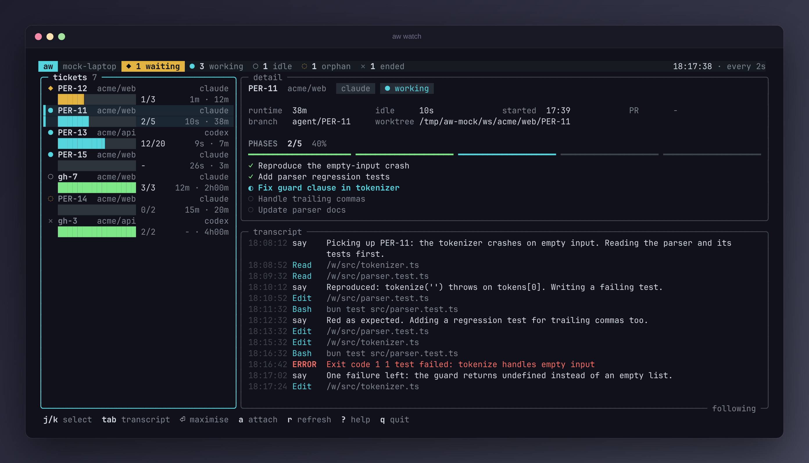
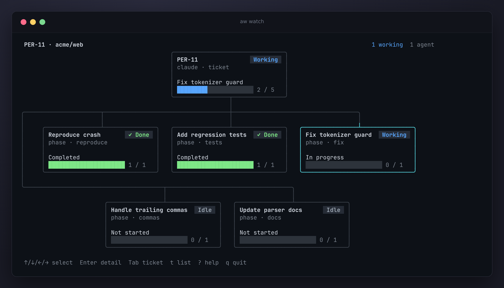

# tender — agent workflow

Move a GitHub issue or Linear ticket to **ready**, and `tender` starts a Claude Code or Codex session for it: in its own git clone, inside the [nono](https://github.com/nolabs-ai/nono) sandbox, in a tmux window you can attach to. The agent implements the ticket, runs the tests, pushes `agent/<ID>` and opens a PR; `tender` then moves the ticket to **In Review**.

- **Watch and steer locally.** `tmux attach -t tender`, or open its clone in your editor. Codex sessions are interactive, so they also land in the ChatGPT/Codex app history. Claude sessions run without Remote Control: they hold an inference-only token (nono's phantom, or the setup-token without a sandbox), which cannot open Remote Control sessions.
- **Runs where you are.** Directly on your machine (sandboxed by nono), or on a VM (`sandbox: "none"`, the VM is the boundary). Same code, same config.
- **No moving parts to babysit.** A small Bun + TypeScript program, no database server, nothing to back up: state is the tracker, the tmux windows and the session clones. Polls instead of webhooks, so nothing listens on a port.
- **Your setup, read-only.** Agents use your `CLAUDE.md`, `AGENTS.md` and skills, but run from their own config dirs (a fresh `<ID>.claude` per Claude ticket and `<ID>.codex` per ticket) and cannot modify yours.





## Features

**Picking up work**
- **Sources:** GitHub issues, with labels over the repos you allowlist, or Linear tickets from a team. Several sources can run side by side.
- **Ready means:** the `agent` label plus `host:<host>`, so a laptop and a VM never take the same ticket. One machine can also take unlabelled tickets (`defaultHost`).
- **Which repo, in what order:**
  - Repo allowlist, checked against GitHub renames and redirects.
  - A Linear ticket names its repo with a label or a `repo:` line in the ticket; otherwise its project picks the repo that claims it in `.tender/config.yaml`.
  - Most urgent tickets start first: Linear priority, or a GitHub `priority:*` label.
- **Limits:** at most `maxConcurrent` sessions in total and per repo; optionally no new starts while `maxInReview` tickets wait in review.

**Running agents**
- **Agents:** Claude Code or Codex, chosen per repo.
- **Isolation:** one git clone and branch `agent/<ID>` per ticket, in its own tmux window.
- **Sandbox:** [nono](https://github.com/nolabs-ai/nono), or none on a VM where the VM is the boundary.
- **Your config, read-only:** a fresh agent config dir per ticket. Agents use your `CLAUDE.md`, `AGENTS.md` and skills but cannot change them.
- **Claude login:** the sandbox holds only a phantom token. `tender` refreshes the host login itself before it expires ([Claude auth](docs/auth.md#claude-auth)).

**While it works**
- **[Phases](docs/lifecycle.md#phases):** a phased plan is mirrored into sub-tickets that track its status.
- **[Questions](docs/lifecycle.md#questions):** a blocked agent's question is posted to the ticket, and your reply is delivered back to the session.
- **[Findings](docs/lifecycle.md#findings):** problems outside the ticket's scope become new tickets, not drive-by fixes.
- **Stall detection:** a session that writes nothing for `stallMinutes` gets `needs-human` and a comment with its last pane lines.

**After the PR**
- **Ticket status:** moves to In Review once the PR exists, then to [Ready to merge](docs/lifecycle.md#ready-to-merge) once the PR is clean and nothing waits on the agent; back to In Review on new commits, a failed check or new feedback.
- **[PR feedback](docs/lifecycle.md#pr-feedback):**
  - Review comments, failed checks and merge conflicts are delivered to the live session.
  - After `feedback.maxRounds` rounds (default 3) the ticket is parked with `needs-human`.
- **[Auto-merge](docs/auto-merge.md#auto-merge):** modes `off`, `all`, `shadow` and `intelligent`, set per path by the repo's `trust` rules. Critical paths and escape hatches (`@ts-ignore`, `eslint-disable`, …) on added lines hold back any mode; `intelligent` adds gates for deleted tests, PR size and the agent's own confidence.
- **Cleanup:**
  - A done or deleted ticket ends its session, and its clone is deleted once nothing is unpushed.
  - A canceled ticket ends its session and keeps its clone.
  - A ticket reassigned to someone else is stopped the same way, with one comment.

**Watching**
- `status [--json]`: every session's state, runtime, phases and PR.
- `watch`: a terminal dashboard with a live transcript and attach and open-PR keys ([Watching sessions](docs/watching.md#watching-sessions)).
- `tail <ID>`: follow one session's transcript.
- `open <ID>`: take a session over in Claude Code, Codex, T3 Code or your editor, outside the sandbox ([Hand-off](docs/hand-off.md#hand-off)); `resume <ID>` gives it back.
- `tmux attach -t tender`: the live terminals, where you can steer an agent directly.

**[PR sweep](docs/prs.md)**
- `prs`: weekly, closes open `agent/<ID>` PRs whose ticket is done or canceled, and reports conflicting, failing, stale and ready-but-unmerged PRs to the journal and an optional digest issue. Never touches other PRs.

**[Intake](docs/intake.md)**
- `intake`: repo scripts that print JSON lines become deduped, sanitized tickets, carrying the rule's `labels`, without the ready label until its `autoLabel` trusts them, and rechecked after they are Done. Runs on one host, on a 15-minute timer, in nono.

## How it works

Every poll (default 60 s), `tender` looks for ready tickets (the `agent` label plus `host:<host>`) in the repos you allowlist, and for each one:

1. clones the repo and makes a session clone on branch `agent/<ID>`;
2. starts the agent in a tmux window, sandboxed by nono, with a prompt built from the ticket and the repo's `.tender/` config;
3. mirrors the agent's phases, questions and findings to the tracker;
4. moves the ticket to In Review when the PR exists, feeds review comments, failed checks and conflicts back to the live session, and optionally auto-merges.

## History: `tender.db`

`run`, `once` and `open` append an event (start, claim, review, ready-to-merge, merged, done, park, stall, feedback-round, gate, handoff; `intake` adds intake-filed, judge, recheck; `prs` adds pr-closed) to `<workspaceRoot>/tender.db`, a SQLite file in WAL mode. It is history for later stats, never state: the tracker stays the truth. It sits outside every session clone and is never granted to the sandbox. A failed write is logged and skipped; `--dry-run` writes nothing. Safe to delete at any time (with its `-wal` and `-shm` files); the next event creates a fresh one. [Intake](docs/intake.md) also keeps its seen keys and last runs there; without them the next intake run searches the tracker for each key again before filing.

## Docs

- [Setup](docs/setup.md): requirements, tracker, config, first run, running as a service, first-run checklist
- [Agent logins](docs/auth.md): Claude and Codex authentication
- [How it works](docs/lifecycle.md): the full poll lifecycle, repo routing, phases, findings, questions, PR feedback, Ready to merge
- [Auto-merge](docs/auto-merge.md): modes, trust per path, critical paths, escape hatches
- [Hand-off](docs/hand-off.md): `open` / `resume` to take a session over
- [Watching sessions](docs/watching.md): `status`, `watch`, `tail`, live state
- [Config reference](docs/config.md): `tender.json` and `.tender/config.yaml`
- [Clones, sandbox and cleanup](docs/sandbox.md): isolation details
- [Intake](docs/intake.md): scripts that file tickets from signals
- [PR sweep](docs/prs.md): `tender prs`, orphan agent PRs and the weekly report
- [Trust signals](docs/stats.md): `tender stats`, per-path merge, revert and shadow numbers and recommendations
- [Code layout](docs/code-layout.md)
- Design notes: [agent questions](docs/agent-questions.md)

## Quick start

```bash
bun install
scripts/setup.sh owner/repo   # config dirs, labels, .env, tender.json for these repos, nono if a repo needs it, login check
scripts/run.sh                # preflight (dry run), then poll in the foreground
```

Details in [docs/setup.md](docs/setup.md).

## Status

Early and used by one person. Linux only; macOS is untested. Auto-merge and the sandbox are guard rails, not guarantees: read [Auto-merge](docs/auto-merge.md) before enabling it, and protect `baseBranch` on GitHub. Bugs and ideas: open an issue.

## License

[MIT](LICENSE)
