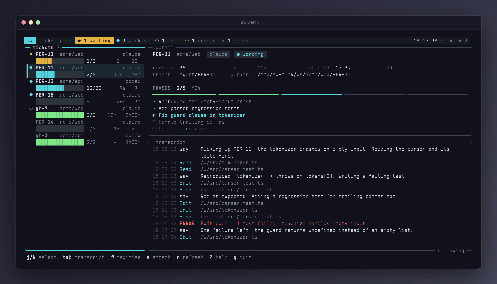

# aw — agent workflow

Move a GitHub issue or Linear ticket to **ready**, and `aw` starts a Claude Code or Codex session for it: in its own git clone, inside the [nono](https://github.com/nolabs-ai/nono) sandbox, in a tmux window you can attach to. The agent implements the ticket, runs the tests, pushes `agent/<ID>` and opens a PR; `aw` then moves the ticket to **In Review**.

- **Watch and steer locally.** `tmux attach -t aw`, or open its clone in your editor. Codex sessions are interactive, so they also land in the ChatGPT/Codex app history. Claude sessions run without Remote Control: it needs a full login, and a shared login does not survive token refresh across sessions.
- **Runs where you are.** Directly on your machine (sandboxed by nono), or on a VM (`sandbox: "none"`, the VM is the boundary). Same code, same config.
- **No moving parts to babysit.** A small Bun + TypeScript program, no database: state is the tracker, the tmux windows and the session clones. Polls instead of webhooks, so nothing listens on a port.
- **Your setup, read-only.** Agents use your `CLAUDE.md`, `AGENTS.md` and skills, but run from their own config dirs (a fresh `<ID>.claude` per Claude ticket and `<ID>.codex` per ticket) and cannot modify yours.

## How it works

`aw.json` has three parts: `repos`, the allowlist of GitHub repos `aw` may work on (with per-repo settings); `defaults` for those settings; and `sources`, where tickets come from (a GitHub label set over the allowlisted repos, or a Linear team). Every `pollIntervalMs` (default 60 s), for each source:

```
ready ticket ──► resolve its repo; not in `repos`, or GitHub redirects it ──► one comment, skipped
             ──► gh repo clone <owner>/<name> ~/agent-repos/<owner>/<name>.tmp-…, then rename   (first time only)
             ──► git clone --shared <that clone> ~/agent-ws/<owner>/<name>/<ID>, branch agent/<ID> from origin/<base>
             ──► tmux window <owner>/<name>/<ID>: systemd-run --scope … nono run … -- claude … "<prompt>"
             ──► In Progress + comment "aw: picked up on <host>"   (move fails ──► session killed, retried next poll; a failed comment is only logged)
.aw/phases.json changed  ──► create / update phase sub-tickets
.aw/question.md changed  ──► comment "aw: question from agent: …"; first reply by a feedbackAuthor ──► .aw/answer.md + one pasted line, once idle
PR for agent/<ID> exists ──► In Review + comment with the PR link
.aw/findings.json (PR open) ──► each entry filed once as an unlabelled ticket + one "aw:" comment linking them
in review, autoMerge on   ──► gh pr merge --squash --delete-branch, ticket Done; or one "aw: not auto-merged" comment per head SHA
in review, window open   ──► feedbackAuthor PR comments, failed checks, conflicts ──► .aw/feedback.md + one pasted line, once idle
session ended, no PR     ──► one comment "aw: session ended without a PR"
3 feedback rounds used   ──► `needs-human` label + one comment; feedback, auto-merge, start and the ended comment pause until a human removes it
`working`, quiet 30 min  ──► `needs-human` label + one comment with the last pane lines; the session keeps running
ticket done / closed     ──► kill session; nothing uncommitted or unpushed ──► delete the session clone
ticket canceled          ──► kill session, keep the session clone and its files until the ticket is done
```

- **Canceled** = GitHub: closed as not planned or duplicate, or deleted. Linear: any state of type Canceled or Duplicate, or trashed (a deleted or trashed ticket is never done, so delete its clone by hand). `aw` kills the session (no Ctrl-C first: transcripts are written as they go), writes `<ID>.ended`, logs `stopped`, posts nothing and deletes nothing. The clone and its files stay until the ticket is done (GitHub: reopen and close as completed; Linear: move it to a `done` state), then cleanup runs as usual; or delete them by hand. A canceled ticket is not in the ready listing, so it is never started. Reopened with the in-progress marker still on, it stays stopped and `aw` logs that once per run (as for any ended session still in progress); remove the `in-progress` label (Linear: move it to `Todo`) to start it again in the kept clone.

- **Ready** = GitHub: open + `agent` + `host:<host>` labels. Linear: `Todo` state + the same two labels.
- The `host:<host>` label decides which machine takes a ticket, so a laptop and a VM never pick up the same one. With `"defaultHost": true` this machine also takes tickets with no `host:` label at all, so on a single laptop you only need `agent`. Set it on one machine only: claiming is not atomic, so two default hosts can both start the same unlabelled ticket.
- The `agent` label is never removed, as a permanent record. On GitHub a ticket is skipped while it has `in-progress` or `in-review`; to re-run one, close its old PR and remove that label.
- **Parked** = the `needs-human` label, matched case-insensitively (Linear: an ungrouped team or workspace label, not a state; `aw` does not create it). `aw` adds it when it hands a ticket to a human (the PR feedback limit, or a stall) and never removes it. While it is there `aw` does not start the ticket, deliver PR feedback, check for stalls, file findings, auto-merge, or post "session ended without a PR"; questions, answers, phases, the move to In Review, the merged-by-hand recovery (see [Auto-merge](#auto-merge)), cleanup of a done ticket and the stop of a canceled one still run; the label never kills a window or deletes anything. Remove the label to resume. A human may add it by hand too. These checks use the poll's listing, except the two hard to undo, which re-read the label first and treat a failed read as parked: an actual merge, and restarting the feedback rounds. The label is a workflow signal, not a security boundary: the agent's GitHub token can edit labels.
- **Stalled** = a session with a tmux window whose own state is `working` (Claude's session record, or the Codex hook, without the 10-minute `unknown` downgrade of `aw status`) and whose transcript, or launcher if it has none, was last written `stallMinutes` (default 30) ago or more. A long build is just as quiet, so set it above your slowest test run. Transcript writes are the signal, not tmux activity, since the agent's spinner redraws the pane while it is busy. `aw` parks the ticket and posts one comment with the last lines of the session's own pane (the pane started by the ticket's launcher script, found by `#{pane_start_command}` so splits and swaps never redirect it; none while it is in copy mode; `tmux capture-pane -p -S -20`, escapes and controls stripped, capped at 1500 chars, fenced); it never kills the window or touches the worktree. `<ID>.stall` records the activity time it reported, so removing the label does not repeat the comment for the same stall; new transcript activity and then another quiet `stallMinutes` comments again. It is written after the comment, so a failed comment is retried once the label is removed. A stall parks the ticket before feedback and auto-merge run in the same poll. Checked each poll for In Progress and In Review tickets that are not parked.
- Ready tickets from all sources are started most urgent first: Linear's priority (Urgent, High, Medium, Low), or on GitHub an optional label `priority:urgent|high|medium|low` (case-insensitive; the most urgent wins if several). No priority goes last; ties keep source order from `aw.json`, then tracker order. `scripts/setup.sh` does not create the `priority:*` labels.
- At most `maxConcurrent` sessions in total, and at most `repos[].maxConcurrent` per repo. Ticket text only ever goes into the prompt file, never into a shell command.

### Which repo a ticket goes to

- **GitHub:** the issue's own repo. A source polls every repo in `repos`.
- **Linear:** the first of: a ticket label `repo:owner/name`; a line `repo: owner/name` in the ticket description (first such line, at the start of a line); the same line in the ticket's project summary, then its project overview. A ticket that names no repo gets one comment and is skipped.
- The result must match a `name` in `repos` (case-insensitive; the configured spelling is then used everywhere). Otherwise the ticket gets a comment (`aw: repo x is not in the aw allowlist`, `aw: no repo set on this ticket`, or `aw: … is not a valid owner/name`) and is skipped, with no worktree. Repo strings from tickets must match `owner/name` of `[A-Za-z0-9_.-]`, owner not starting with `-` or `.`, no `..`, name not `.` and not ending in `.git`, and only reach `gh`/`git` as argv.
- GitHub serves a renamed or transferred repo under its old name (asking for `zeit/next.js` returns `vercel/next.js`). So before listing a repo's issues, and before cloning or starting any ticket, `aw` checks `gh repo view <repo> --json nameWithOwner` equals the allowlisted name (case-insensitive). The check before listing is cached for 5 minutes; the one right before cloning or starting a ticket is never cached. On a mismatch the repo is skipped and logged, and a Linear ticket for it gets the rejection comment; a failed lookup skips the repo (or the start) for that poll, without a comment.
- Only Linear tickets are rejected (a GitHub ticket's repo is allowlisted by construction; a redirected one is only logged). A Linear ticket gets at most one rejection comment ever, whatever the reason and from however many sources, recorded in `<workspaceRoot>/.rejected/<ID>` before the comment is posted: a crash in between loses the comment rather than repeating it, and a failed post clears the record so the next poll retries. Starting the ticket later does not clear it.
- Each worktree has a `<ID>.source` file next to it, outside the sandbox, naming the source that started it. Only that source acts on the worktree (cleanup, in-progress and in-review checks, phases, "ended without a PR"); others ignore it. If that source is no longer in `aw.json`, the worktree is left alone and logged once per run. Nothing inside the worktree is trusted for this. A ready ticket whose `<ID>.source` names another source (configured or not) is skipped and logged; only the owner restarts it. A Linear ticket keeps the repo it was started in even if its label or description changes later; while it has a window, or a worktree or `.source` in any `<workspaceRoot>/<owner>/<name>`, it is not started in another, also when that repo has since been removed from `repos` (its worktree is then left alone).

### Phases

The default prompt has the agent plan with the `agent-orchestration` skill. It forbids any attribution (`Co-Authored-By`, "Generated with ...", emoji signatures) in commits, PR titles/bodies and ticket comments. When it splits the work into phases it writes them to `.aw/phases.json` in its worktree (git-ignored via `.aw/.gitignore`): an array of `{ key, title, body, status }`, status `todo` → `in-progress` → `done`. The agent never talks to the tracker; on every poll, for each of its in-progress and in-review tickets, `aw` mirrors the file:

- a new `key` → a sub-ticket of the parent titled `<ID>: <title>`, with no labels (GitHub: `gh issue create --parent`; Linear: child issue in `Todo`, same team);
- `in-progress` → the `in-progress` label / `In Progress` state;
- `done` → shown as in-progress while the parent is In Progress; closed / first `done` state once the PR exists, just before the parent moves to In Review. Closing children mid-session could trip Linear's team setting "auto-close parent when all sub-issues are done" and `aw` would then clean up the running session.

Phases are history, not a gate: the same session works the ticket to the PR, and the parent's lifecycle is unchanged. Sub-tickets lack the `agent` label, so they are never picked up as work, `defaultHost` included. Created refs and synced statuses live in `<workspaceRoot>/<owner>/<name>/<ID>.phases.json`, outside the sandbox, written atomically. Before creating a sub-ticket `aw` lists the parent's existing ones and adopts one with the same `<ID>: <title>` that it has no record of, so a crash or lost response between creating and recording doesn't duplicate it. Tickets in review keep syncing every poll, so a failed final sync is retried. The file is untrusted: max 64 KiB and 20 phases, `key` `[a-z0-9-]{1,40}` starting with a letter or digit, one-line title ≤ 120, body ≤ 4000; `.aw` and the file are opened without following symlinks (the directory is pinned by fd via `/proc`, so Linux only) and anything but a regular file is rejected. An invalid file is logged and skipped for that poll, and a status moving back is ignored. Cleanup leaves sub-tickets as they are.

### Findings

The prompt forbids fixing, or leaving TODO comments for, problems outside the ticket's scope. The agent lists them in `.aw/findings.json` instead: an array of at most 5 `{ title, body }`, read like `phases.json` (max 64 KiB, no symlinks, regular file only; a wrong shape is logged and skipped for that poll). Once the PR exists, `aw` files each entry as a new ticket in the same repo (GitHub: `gh issue create`, no labels, no parent) or team (Linear: `Todo`, no labels, no parent), then posts one `aw:` comment on the source ticket linking the batch. It runs at the move to In Review and every poll while In Review, so entries added while addressing feedback are filed too. The ticket comment, not the PR, carries the links: it works for both trackers and stays after the PR is merged. Filed tickets lack the `agent` label, so they are never picked up as work; a human triages them. Title and body are untrusted: control and escape characters are stripped, the title is one line capped at 120 chars, the body at 4000, every `@name` gets a zero-width space after the `@`, and any word that resolves to a `linear.app` host (also percent-encoded, fullwidth or with invisible characters) is replaced by `[linear[.]app link removed]` (Linear turns profile URLs into mentions), so filing pings no one. Each body ends with a line saying it was filed from the agent session on `<ID>`. `<ID>.findings`, next to the worktree, records each entry's hash just before its create and is never rolled back: a crash or failed create loses that finding (the comment lists it as not confirmed filed), never files it twice. It also keeps each created ticket's URL until the linking comment posts, so a failed comment, or a crash before it, is retried every poll. The comment ends with an `aw-findings <hash prefixes>` line; a retry first reads the ticket's comments and skips entries already listed there, so a comment whose response was lost is not posted twice (a failed or incomplete read defers to the next poll; any `aw:` comment with that line counts, so a forged one can suppress the links). The sidecar is read like `phases.json` (max 16 KiB, no symlinks) and validated (hash format, title length, URL on the ticket's own host in issue shape); anything off fails closed: nothing is filed or posted for that ticket, and titles are re-sanitized when posted. At most 5 are filed per ticket over the whole session, whatever the file says later. Skipped while parked; a ticket merged while parked never files its findings.

### Questions

Every comment `aw` posts starts with `aw:`. A blocked agent writes `.aw/question.md` (Markdown, ≤ 8000 chars after trimming, no control characters but newline and tab, read like `phases.json`) and stops. While the ticket is in progress with no PR and its window open, each poll `aw` hashes the file and, when it changed (or the same question is still there after its answer was recorded), records `{hash, postedAt}` in `<ID>.question` before commenting `aw: question from agent:` and the text (a crash or failed post loses the question, never doubles it; an invalid file is logged and not posted).

The answer is the first comment created after `postedAt` whose author is in the repo's `feedbackAuthors` (GitHub login or Linear user email, case-insensitive) and whose body does not start with `aw:` (aw posts with your credentials). Later comments and edits are ignored. Empty `feedbackAuthors` (default): questions are posted, answers never delivered. Once the session is `idle` (see [Live state](#live-state); `waiting` may be a permission prompt) and its tmux window exists, `aw` records the answer's id in the sidecar, writes `.aw/answer.md` as `<answer from="<author>" ticket="<ID>">…</answer>` (truncated to 8000 chars), pastes `Your question was answered by the operator: read .aw/answer.md` plus Enter into the pane started by the ticket's launcher script, found by `#{pane_start_command}` so splits and swaps never redirect it (skipped while in copy mode), and removes `.aw/question.md` if unchanged. Answer text never goes through keystrokes. Each answer is pasted at most once; a new question starts a new round. `aw status` / `aw watch` show `question` while a posted question is open, the session is `idle` and there is no PR. Design: [docs/agent-questions.md](docs/agent-questions.md).

### PR feedback

While an In Review ticket's tmux window exists and its PR is open, each poll `aw` views the PR and collects, since the cursor in `<ID>.feedback`: reviews with text or "changes requested", PR comments and line comments whose author is in `feedbackAuthors` (same rule as answers; empty = no comments are read); failed checks, once per head SHA (the last 10 reported are remembered) and only when none is pending, with the last 80 lines of `gh run view <run> --log-failed` (streamed through `tail`) for up to 3 Actions runs; and `mergeStateStatus` `DIRTY`, once per head SHA, as "rebase on origin/<base> and resolve the conflicts". It waits while the newest comment is under 2 minutes old, so a review still being written is sent as one. Then, once the session is `idle`, it records the cursor, writes `.aw/feedback.md` (`<feedback>` with `<comment>`, `<failed-check>`, `<log>`, `<conflict>`; comments truncated to 8000 chars) and pastes `There is new feedback on your PR: read .aw/feedback.md` the same way as an answer, at most once per round. The ticket stays In Review (moving it back would make the next poll move it forward again and repost the PR link). After 3 rounds, the next batch of feedback parks the ticket with `needs-human` (if adding the label fails, nothing else happens and it is retried next poll), marks the cursor `capped` and gets one `aw: PR feedback stopped after 3 rounds …: a human is needed` comment instead. While parked nothing is read or pasted. Once a human removes the label, the rounds start again from 0 (seen comments and reported SHAs are kept), so feedback that arrived meanwhile is delivered as the next round. Upgrading: a ticket capped before the label existed has no label, so it counts as resumed and gets 3 more rounds. A session whose window is gone gets nothing.

### Auto-merge

`autoMerge` (in `defaults` or per repo) lets `aw` merge a ticket's PR; the prompt forbids the agent to merge. That is a prompt rule, not a boundary: the sandbox's GitHub token can reach `/repos/**` and `/graphql` (`gh pr create` needs GraphQL, and nono filters only method + path, not the mutation), so a prompt-injected agent can still `gh pr merge` or push to `baseBranch` itself, even with `autoMerge: "off"` or `no-automerge`. The real boundary is GitHub branch protection on `baseBranch` (required PR, required status checks); enable it. On every poll, for each in-review ticket with an open PR on `agent/<ID>`, `aw` reads `gh pr view --json …` and decides:

- `off` (default): never merges.
- `all`: merges when the PR is open, not a draft, from this repo (not a fork), targets `baseBranch`, has no conflicts, no review decision "changes requested", no check failed or pending (zero checks is fine), and neither the PR nor the ticket has the label `no-automerge`.
- `intelligent`: the same, plus gates `aw` computes from the PR itself. Never merged: any changed file matching a critical path, or a large change. Size is additions + deletions and changed files: small ≤ 150 lines and ≤ 5 files, medium ≤ 500 and ≤ 15, else large. Small needs nothing more (zero checks is fine). A PR that renames a file is never merged (`files` gives only the new path). Medium also needs at least one check that succeeded (skipped or neutral ones don't count), and a valid `.aw/merge.json` from the agent with `tested: true`, `confidence: "high"`, `critical: false`.

The agent writes `.aw/merge.json` (`{ "tested", "confidence": "high|medium|low", "critical", "reason" }`, max 4 KiB, read like the phases file: no symlinks, regular file only) just before opening the PR. Ticket text can steer the agent, so the file is untrusted: it can only hold a merge back (`critical: true` or `confidence: "low"` blocks any size; missing or invalid blocks medium), never let one through. Built-in critical paths (case-insensitive globs on the repo-relative path; a pattern without `/` matches the file name at any depth): `.github/**`, `**/Dockerfile*`, `docker-compose*`, `**/migrations/**`, `**/*.sql`, `package.json`, `bun.lock*`, `package-lock.json`, `pnpm-lock.yaml`, `yarn.lock`, `go.mod`, `go.sum`, `Cargo.toml`, `Cargo.lock`, `pyproject.toml`, `requirements*.txt`, `**/auth/**`, `**/*secret*`, `**/*.env*`, `**/*.pem`, `**/*.key`, `nono/**`, `aw.json`, `**/infra/**`, `**/terraform/**`, `**/deploy/**`. `criticalPaths` adds to them.

Pending checks or unknown mergeability wait silently. A merge is `gh pr merge <n> --squash --delete-branch --match-head-commit <sha>` (never `--admin`), so a push after the decision makes it fail. Right before merging `aw` views the PR again and re-runs every gate. A failed merge is logged and retried next poll, and so is a PR not yet `MERGED` after the command (merge queue). After a merge `aw` comments once, closes the GitHub issue / moves the Linear ticket to the first `done` state, and cleanup follows. A PR found merged on a later poll (also by hand) moves the ticket the same way if it is from this repo and targets `baseBranch`, which retries a failed close; this also runs on a parked ticket, which otherwise gets no merge and no comment. A PR that is not merged gets one `aw: not auto-merged: <reason>` comment per head SHA, recorded in `<ID>.merge` next to the worktree; it is re-evaluated every poll, so a re-run check or a removed label still lets it merge without a new commit.

## Quick start

```bash
scripts/setup.sh owner/repo   # config dirs, nono, labels, .env and aw.json from the examples, login check
scripts/run.sh                # preflight (dry run), then poll in the foreground
```

The same are available as `bun run setup owner/repo`, `bun run start`, `bun run once`, `bun run service`, `bun run status`, `bun run watch`, `bun run dry`, `bun run test` and `bun run typecheck` (`tsc --noEmit`; run `bun install` once for `@opentui/core`, the `watch` dashboard's only runtime dependency, and the dev-only `typescript` and `bun-types`; if it cannot be loaded `watch` falls back to plain output, and nothing else needs it). Edit `repos` and `sources` in `aw.json` before running. `scripts/run.sh once` does a single pass; `scripts/run.sh service` installs and starts the systemd user unit. `run` and `once` hold a kernel lock on `<workspaceRoot>/.lock` while they live, so a second one on the same workspace exits with an error (`--dry-run`, `status`, `watch` and `tail` take no lock). The agent logins below are interactive; `scripts/setup.sh` prints what is still missing.

## Setup

### 1. Requirements

Linux. On `PATH`: `bun`, `git`, `gh` (logged in: `gh auth status`), `tmux`, GNU `timeout` (coreutils; bounds every command `aw` runs), a systemd user manager (`systemd-run --user`, `systemctl --user`; each session runs in its own scope), and `claude` and/or `codex`. The default prompt needs the `agent-orchestration` skill installed globally in `~/.claude/skills` (`scripts/setup.sh` links that dir into both agent config dirs). For sandboxed repos, install nono:

```bash
curl -fsSL https://nono.sh/install.sh | sh
```

### 2. Agent config dirs and logins

```bash
scripts/setup.sh owner/repo
```

Idempotent, never overwrites real files. It creates `~/.claude-aw` and `~/.codex-aw` (symlinking your `CLAUDE.md`, `AGENTS.md`, skills), creates `~/agent-ws` and `~/agent-repos`, and creates the labels for each repo you pass. Then log the agents in — these are separate from your own sessions:

```bash
CLAUDE_CONFIG_DIR=~/.claude-aw claude
```

Run `/login` inside, then exit. Sessions do not use that login (only its onboarding and account keys, see below); they authenticate with a long-lived token:

```bash
claude setup-token   # prints the token; save it with:
install -m 600 /dev/stdin ~/.claude-aw/oauth-token   # paste, then Ctrl-D
```

The launch script reads it on the host and passes it to the sandbox as `CLAUDE_CODE_OAUTH_TOKEN`, so it never lands in the script, the prompt or the logs, and the session cannot read the file. A Claude start fails while the file is missing. Copying `.credentials.json` per ticket would not work: Claude rotates refresh tokens, so the copies would log each other out.

```bash
CODEX_HOME=~/.codex-aw codex login
```

#### Codex auth

Codex uses that ChatGPT login, so sessions draw on your plan's Codex limits (Plus, Pro, Business or Enterprise), shared by all concurrent sessions. Each ticket gets its own `CODEX_HOME`, `<workspaceRoot>/<owner>/<name>/<ID>.codex`, recreated at every start from the `~/.codex-aw` template: a copy of `config.toml` (and `hooks.json`), `AGENTS.md` and `skills` linked to their resolved targets, and `auth.json` (0600). Sessions cannot read or write the template, so a session cannot plant config, MCP servers, hooks, instructions or transcripts for other tickets.

Only the host holds the refresh token. ChatGPT refresh tokens rotate and Codex rejects a reused one, so a copy that could refresh would log the template out. The ticket's `auth.json` holds only what an access-token login needs, copied from the template: `auth_mode`, `last_refresh` and the tokens' `id_token`, `access_token`, `account_id`, `login_owner_id` and `oauth_provenance`, with `refresh_token` set to `""` (Codex refuses the file without the key). Anything else in the template (an API key, a personal access token, Bedrock keys, fields a newer Codex adds) stays on the host. It carries the access token, which lives 10 days and which the session can read: its own credential, like the Claude token. Before copying, if the template's access token (its JWT `exp`) expires within 24 hours, `aw` refreshes it on the host: Codex has no refresh command, so `aw` runs `CODEX_HOME=~/.codex-aw codex app-server` and sends `account/read` with `refreshToken: true` (the app-server's forced refresh), waiting for the reply before closing it, under `flock` on `~/.codex-aw` so two `aw` processes never refresh at once. A refresh killed at its 60 s deadline after the server rotated the token but before Codex saved it loses the template login; log in again. If the token still expires within 24 hours afterwards, or the template has no ChatGPT login, the start fails with the fix (`CODEX_HOME=~/.codex-aw codex login`) in the log. A Claude start never fails over it; its Codex is then just not logged in. So a session starts with at least a day of token. If it runs past expiry, Codex tries to refresh with the empty token, which fails, and its requests fail with "Your access token could not be refreshed…": the session stays open but cannot work, and likely reads as idle rather than stalled (from the Codex source; not checked live). Restart the ticket for a fresh copy.

No trust step: Claude keys folder trust on the git repository root ([docs](https://code.claude.com/docs/en/permissions#project-allow-rules-and-workspace-trust)), here the session's own clone, so trusting `~/agent-ws` or your home does not cover it. Each Claude ticket gets its own config dir, `<workspaceRoot>/<owner>/<name>/<ID>.claude`, which `aw` recreates at every start: symlinks to the template's `settings.json`, `CLAUDE.md`, `AGENTS.md`, `skills` and `plugins` (resolved, so they point at the real files), and a `.claude.json` holding only the template's onboarding and account keys plus `projects["<session clone>"].hasTrustDialogAccepted` (the documented way to trust a folder by hand), so the session starts without the dialog. `~/.claude-aw` is the template: sessions can write only their own dir and read only the template's `settings.json` and `plugins/`, so a session cannot plant hooks, instructions, MCP servers or plugins for other tickets. Anything it leaves in its own dir is gone at the next start and at cleanup.

Check the sandbox profiles parse:

```bash
nono profile validate nono/aw-claude.json
```

```bash
nono profile validate nono/aw-codex.json
```

```bash
nono profile validate nono/aw-check.json
```

### 3. Tracker

**GitHub:** create the labels in each repo (`scripts/setup.sh` prints these with your host name):

```bash
for l in agent in-progress in-review needs-human "host:$(hostname -s)"; do gh label create "$l" --repo owner/repo --force; done
```

**Linear:** create the labels `agent`, `needs-human` and `host:<host>` in the team (`needs-human` may be a workspace label; `aw` does not create it and parking fails with an error naming it when it is missing), make sure it has `Todo`, `In Progress`, `In Review`, `Done` states (or set your names in the config), and put a personal API key in `.env` (gitignored, loaded by Bun from the working directory):

```bash
cp .env.example .env
```

A Linear ticket names its GitHub repo with a label `repo:owner/name`, or a line `repo: owner/name` in its description or its project's summary or overview; otherwise it is skipped with one comment (see [Which repo a ticket goes to](#which-repo-a-ticket-goes-to)).

### 4. Config

```bash
cp aw.example.json aw.json
```

Set `host` to the name in your `host:` label, list every repo `aw` may work on under `repos` (a plain `"owner/name"` takes the `defaults`; `{ "name": "owner/name", … }` overrides them), and add one source per GitHub label set / Linear team. `aw.json` is gitignored. See [Config reference](#config-reference).

`aw` clones each repo into `<reposRoot>/<owner>/<name>` (default `~/agent-repos`) with `gh repo clone` the first time a ticket needs it, into `<path>.tmp-…` and renamed when done, so an interrupted clone is never used. Every command `aw` runs has a 60 s deadline (`timeout -k 5`, whole process group), so a hung `gh`, `git` or `tmux` fails that step instead of stalling polling; `gh repo clone`, `git fetch`, the session clone and its checkout get 15 min, and so does deleting a session clone. If `path` exists but is not the top of its own clone (`git rev-parse --git-common-dir` is not `<path>/.git`: an interrupted clone, or a subdirectory or linked worktree of another clone), or resolves to the same directory as another repo's `path`, the ticket is not claimed and the error is logged; `aw` never deletes it, so fix or remove it (and any stale `.tmp-…` sibling) by hand. Leave the clone there, or point `repos[].path` at another clone that is also used only by `aw`. Never point it at your working clone. Only `aw` writes it: it fetches `origin/<base>` there before each start.

Each session works in its own clone, `<workspaceRoot>/<owner>/<name>/<ID>`, made by `git clone --shared --revision refs/remotes/origin/<base>` from that base clone: it borrows the base's objects through `.git/objects/info/alternates` instead of copying them, so it is cheap at any repo size. `aw` then points its `origin` at the base's own remote URL (so `git push` and `gh pr create` work as before), sets the usual fetch refspec with `tagOpt=--no-tags` (so a fetch brings in no tags) and `origin/<base>`, and creates `agent/<ID>`, all in `<ID>.tmp`, renamed to `<ID>` only when complete (a failed step deletes it); if the base still has an `agent/<ID>` branch from an older worktree session, the new branch starts there. A borrowed object must never disappear from the base, so `aw` never prunes it (its git calls pass `maintenance.auto=false`) and sets `gc.pruneExpire=never` in the base's config, which keeps a manual `git gc` there from deleting objects too (`git gc --prune=now` and `git prune --expire=now` still do, so never run them there). `--local` with hardlinks was rejected because the session could write through a hardlinked object file into the base, and `--no-hardlinks` copies every object per session. Under nono the session can write only its own clone (whose `.git`, config and hooks included, nothing else uses) and read only the base's `.git/objects`; the base's refs, config, hooks and every other session are out of reach. `git push -u` records the upstream, since the session's config is its own. `aw` never runs git inside a session clone on the host once the session has started, because its config, hooks and filters are agent-controlled. At cleanup it runs `git status --porcelain --ignore-submodules=none`, `git log --branches --not --remotes` and `git for-each-ref refs/tags refs/stash refs/notes` under nono with `nono/aw-check.json`: read-only on the clone and the base's objects, no network and no credentials, so a filter or config the session planted runs with neither, and deletes the clone with `rm -rf --one-file-system`, which removes symlinks without following them, only if all three print nothing and exit 0: a done ticket with uncommitted, untracked or unpushed work, or any tag, stash or note (a fresh clone has none), keeps its clone, which is logged and retried every poll until you push or delete it. The session can make its own check print nothing, which then deletes its clone. With `sandbox: "none"` the same checks run unsandboxed, since that agent runs unsandboxed anyway. Like every command `aw` runs, the checks have a 60 s deadline (`timeout -k 5`, which kills the whole process group), so a planted filter that never returns cannot stall polling; on a timeout the clone is kept. A dir whose `.git` is not a directory is kept and logged.

`aw`'s own `git` calls also pass `-c` overrides (`core.hooksPath`, `core.fsmonitor`, `core.alternateRefsCommand`, `maintenance.auto`, and the `ext`, `file` and `git://` transports) as a second layer; only the local copy that creates a session clone re-allows `file`. Because of the `file` override, the clone's `origin` must be an HTTPS or SSH URL; a clone of a local path fails at `git fetch` (`transport 'file' not allowed`).

Unix sockets: Landlock's file rules do not cover `connect()` to a socket, so both profiles set `linux.af_unix_mediation: "pathname"`. Without it, a session could reach your tmux server (`tmux new-window <cmd>` runs on the host), the systemd user manager, D-Bus, gpg/ssh agents, Hyprland and other Claude sessions under `$XDG_RUNTIME_DIR/cc-socks`. The profiles add no host sockets; nono's inherited `default` profile allows connecting to the systemd userdb sockets in `/run/systemd/userdb` (`io.systemd.Multiplexer`, `DropIn`, `NameServiceSwitch`, `DynamicUser`), which answer user and group lookups. The launcher adds `--allow-unix-socket-subtree-bind` for the clone and for the session's temp dir (below), so a session can bind and connect sockets only there; sockets elsewhere (`/tmp` included) and in the abstract namespace fail with `EACCES`. `gh` cannot read `~/.config/gh` in the sandbox and exits if it cannot load its config, so the launcher sets `GH_CONFIG_DIR=<clone>.gh`, a path that never exists: `gh` runs on its defaults with nono's `GH_TOKEN`, and your `gh` config (aliases, `git_protocol`, extensions) does not apply in sessions. gh, git and the GitHub credentials go through nono's TCP proxy, and Codex runs with `--no-daemon`, so neither needs a socket. Claude's inter-session messaging socket (`cc-socks/<pid>.sock`) is denied, and sessions run without it.

Terminals: both profiles exclude nono's `system_read_linux_core` and `system_write_linux` groups, which grant `/dev/pts`, and re-add their other paths. A session reaches its terminal through `/dev/tty` and the pty nono gives it, but cannot open any other `/dev/pts/N`, so it cannot read what you type in another pane or shell, or write escape sequences into it. `/dev/ptmx` is denied too, so a session cannot allocate a pty of its own: Codex's `exec_command` with `tty: true` fails, and plain (pipe) commands, which Claude Code and Codex use by default, are unaffected.

Temp dir: each session gets its own `<ID>.tmpdir` next to its clone, emptied and recreated (mode 700) by `aw` on the host at every start and deleted at cleanup. The launcher exports it as `TMPDIR`, `TMP`, `TEMP` and Claude's `CLAUDE_CODE_TMPDIR`, so `mktemp`, `os.tmpdir()`, Python's `tempfile` and tools that follow them, socket-creating test suites included, land there. Under nono it also holds the session's `XDG_CACHE_HOME`, `<ID>.tmpdir/cache`, so Claude's cache and logs (`claude-cli-nodejs`) and other tools' caches are per session: no profile grants your `~/.cache`, which your own Claude Code also uses. It is a sidecar rather than a dir in the clone so temp files never show in `git status` or block cleanup. Both profiles exclude nono's `system_write_linux` group, the only one granting `/tmp`, and re-grant its `/dev` and `/proc/self/fd` entries except `/dev/pts`, so a session can no longer write the `/tmp` it shared with your host and other sessions; a tool that hardcodes `/tmp` fails (reading there was already denied). A Unix socket path is at most 107 bytes: with `~/agent-ws/nejcm/agent-workflow` and an ID like `ENG-12345` the temp dir is 57 bytes, which leaves 50 for the socket's own path, so a long `workspaceRoot`, owner or repo name can make a test suite's socket fail with `AF_UNIX path too long`; keep `workspaceRoot` short.

Stopping: the launcher runs each session in its own systemd user scope, `aw-<hash>:<owner>:<name>:<ID>.scope`, where `<hash>` is the first 8 hex chars of the SHA-256 of `workspaceRoot` (`systemd-run --user --scope --collect`, with or without nono), because `tmux kill-window` only hangs up the pane: a session that ignores `SIGHUP` or `setsid`s a child keeps running, with its credentials and network. Every stop (done, canceled, a failed claim) first runs `systemctl --user kill --signal=KILL` on that scope, which kills every process in it, then kills the window; a scope that is gone is fine. A start kills any scope left under the ticket's name first, and fails (logged, ticket not claimed, retried next poll) if the user manager cannot be reached, so `aw` never starts a session it could not stop. Each pass, before any start, also kills every scope of this workspace that holds none of its tmux session's pane processes (an orphan, whatever its ticket's state; renaming a window does not count), and kills nothing if the panes cannot be listed. The sandbox cannot reach the user manager's sockets, so a session cannot leave its scope. `systemctl --user list-units 'aw-*'` lists them; a session started before scopes existed has none and is stopped by kill-window alone.

### 5. First run

Dry run — logs every side effect instead of doing it:

```bash
bun aw.ts once --dry-run
```

Then label one test issue `agent` + `host:<host>` and run a single real pass:

```bash
bun aw.ts once
```

```bash
tmux attach -t aw
```

Go through the [first-run checklist](#first-run-checklist) before pointing it at real tickets.

### 6. Run continuously

Foreground:

```bash
bun aw.ts run
```

Or as a systemd user service (edit `WorkingDirectory` (it points at `~/Work/agent-workflow`) and `PATH` in the unit first; the unit's `WorkingDirectory` holds the `.env`):

```bash
cp systemd/aw.service ~/.config/systemd/user/ && systemctl --user enable --now aw
```

`KillMode=process` keeps agent sessions alive when the service restarts. `bun aw.ts status` lists sources, repos (with their `autoMerge`) and one row per worktree; see [Watching sessions](#watching-sessions).

### Watching sessions



Claude Code and Codex can't import a session while it runs, so observe it instead of resuming it:

- `tmux attach -t aw`: the live terminals, one window per ticket (`owner/name/ID`). Detach with `Ctrl-b d`; typing there steers the agent.
- `bun aw.ts status [--json]`: per worktree its agent, session (`running`: tmux window and no `<ID>.ended`; `ended`; `orphan`: neither), live state (see [Live state](#live-state)), runtime (since `<ID>.sh` was written; JSON `startedAt`, ms epoch), idle (since the transcript was last written), phases `done/total` (`.aw/phases.json`, else the `<ID>.phases.json` sidecar; JSON also lists up to 20 as `phases.items` with `key`, `title` and `status`, titled by key from the sidecar) and PR (from `<ID>.pr`, which `aw` writes whenever a poll finds the ticket's PR: in progress, and in review via the auto-merge lookup, or with `autoMerge` `off` every poll while the window exists, else once; must be a `https://github.com/<owner>/<name>/pull/<n>` URL in a regular file under 512 bytes; `held` when `<ID>.merge` records a "not auto-merged" decision). No network calls.
- `bun aw.ts watch [--interval 2] [--plain]`: a terminal dashboard (OpenTUI), refreshed every `--interval` seconds (default 2, min 1); see below. `--plain`, or stdin/stdout not a TTY, redraws the `status` output instead until `Ctrl-C`; if OpenTUI cannot start, or `@opentui/core` is not in a `node_modules` above `src/`, it prints one line to stderr and does the same (that check assumes Bun's default auto-install, which only downloads when no `node_modules` exists; `install.auto = "force"` in a bunfig still fetches).
- `bun aw.ts tail <ID | owner/repo/ID> [-n 20] [--no-follow]`: read-only, one line per assistant message, tool call (name, cut to 6 columns with `…`, and a short argument) or tool error from the newest transcript (last 256 KiB), then follows it, switching (with a new `#` header) to a newer one when the session starts another (restart, `/clear`). Claude's are `<ID>.claude/projects/<cwd, non-alphanumerics as ->/*.jsonl`; Codex's are `<ID>.codex/sessions/**/*.jsonl`; both are matched by the `cwd` they record, and symlinks and non-regular files are skipped. An ID with transcripts in several repos is refused; name the repo. Tool output is never printed; text is capped and stripped of control and escape characters. Works for a finished ticket whose worktree is gone, as long as its transcript is (it goes with the ticket's `<ID>.claude` or `<ID>.codex` at cleanup or restart).

The dashboard has a header (host, a count per state: `◆ waiting` highlighted since it needs you, `◇ question` when any, `● working`, `○ idle`, `◌ orphan`, `✕ ended`, plus `? unknown` when any; last refresh), a footer with the keys that apply right now and transient messages, and between them:

- On a terminal at least 110 columns wide, the ticket list on the left and the selected ticket on the right. Each ticket is a card: state glyph, ID, repo, agent, then a phase progress bar with `done/total`, idle and runtime (one line per ticket when the list is short on rows). Waiting tickets sort first, then question, working, idle, unknown, orphan, ended, by ID within each; the selection follows the ticket across refreshes. The right side shows the ticket's title row (agent, state and what it is waiting for), runtime, idle, start time, PR (`held` when not auto-merged), branch and worktree, its phases (one bar segment per phase, then a checklist; `+N more` when they don't fit) and below, the live `tail` of its transcript, read incrementally and only for that ticket (wrapped under the message column).
- Narrower terminals stack the list (one line per ticket), the detail and the transcript; below 50 columns or 14 rows only the list and the transcript's last lines are shown.

Colours are truecolor; `NO_COLOR` (set and non-empty) switches to bold, dim and reverse only. Keys:

| key | |
|---|---|
| `j`/`k`, `↓`/`↑` | select; scroll the transcript while it has focus |
| `g` / `G` | first / last; top / follow while the transcript has focus |
| `Tab` | move focus between the list and the transcript (the focused pane has the bright border) |
| `Enter` | maximise the transcript, again to go back |
| `Esc` | close help, or leave the maximised transcript |
| `a` | show the ticket's tmux window: outside tmux the dashboard suspends and runs `tmux attach` (detach with `Ctrl-b d` to come back); inside tmux it runs `tmux switch-client` so your client switches to the `aw` session without nesting (switch back with `Ctrl-b (`/`)` or `L`). Needs a `running` window. |
| `o` | open the PR with `xdg-open` (only `https://github.com/<owner>/<repo>/pull/<n>` links) |
| `r` | refresh now |
| `?` | key help overlay |
| `q`, `Ctrl-C` | quit; the terminal is restored on every exit (also `SIGTERM`, `SIGHUP`, crashes) |

Everything shown is stripped of control, escape, bidi and invisible characters (zero-width joiner and non-joiner are kept for emoji and Persian/Indic text) and cut to the column width. Codex rows show `unknown` without aw's hooks in the template (see [Live state](#live-state)).

### Live state

`state` (`working`, `waiting`, `idle`, `question`, `ended`, `unknown`; JSON also has `waitingFor` and `stateSince`, ms epoch or `null`). An `ended` or `orphan` session is `ended` in JSON; the table and dashboard show an `orphan` session (no tmux window, no `<ID>.ended`) as `orphan`. Otherwise:

- Claude: the session records `claude agents` reads, `<ID>.claude/sessions/<pid>.json`, once per refresh for each Claude ticket with a tmux window. `aw` reads them itself, never running `claude` against a dir the session can write: no symlinks, regular files under 64 KiB, and only records whose pid is still running with the recorded start time. `busy` is `working`, `waiting` carries `waitingFor`. The session must report the worktree path as its exact `cwd`. The format is undocumented (checked on 2.1.323): if it changes, Claude rows show `unknown`.
- Codex: hooks installed by `scripts/setup.sh` (via `scripts/codex-hooks.sh`, a marked block in `~/.codex-aw/config.toml`; the rest of the file is left alone, and the script refuses damaged markers or a result that is not valid TOML) write `{state, ts}` to `<worktree>/.aw/codex-state.json` on `SessionStart`/`Stop` (idle), `UserPromptSubmit`/`PostToolUse` (working), `PermissionRequest` (waiting) and `SessionEnd` (ended), only when `.aw` is a real directory. The sandbox only lets an agent write its own worktree, so it can at most misreport its own state. The hook runs with the agent's own privileges, so a race on `.aw` or the temp file reaches nothing the agent could not write anyway. It assumes the session starts at the worktree root, as the launcher does. Codex keys hook trust on the config file's path, so a fresh `<ID>.codex` would skip them; the launcher passes `--dangerously-bypass-hook-trust` instead, since the hooks come only from the template, which sessions cannot write. That also runs hooks from the repo's own `.codex/` config untrusted, with the session's own privileges. `aw` reads the file like `phases.json` (no symlinks, regular file under 4 KiB) and only if it is newer than the launcher; a `working` older than 10 minutes with no transcript write since is `unknown`.

### On a VM

Same steps on the VM (Tailscale for access), with `"sandbox": "none"` in `defaults` (or per repo) and `"host": "vm"` in `aw.json`. Tickets labelled `host:vm` go there. Connect your editor with Remote-SSH to `~/agent-ws/<owner>/<name>/<ID>`.

## Config reference

| key | default | |
|---|---|---|
| `host` | required | matches the `host:<host>` label |
| `defaultHost` | `false` | also take tickets with no `host:` label (not other hosts') |
| `pollIntervalMs` | `60000` | min 5000 |
| `workspaceRoot` | `~/agent-ws` | session clones (`<owner>/<name>/<ID>`), prompts, launchers, sidecars |
| `reposRoot` | `~/agent-repos` | `aw`-managed clones, `<owner>/<name>`, cloned on first use |
| `tmuxSession` | `aw` | |
| `maxConcurrent` | `2` | sessions in total |
| `stallMinutes` | `30` | a session `working` with no transcript write for this long is parked, see **Stalled** below |
| `repos` | required | allowlist array: `"owner/name"`, or `{ "name": "owner/name", …overrides }`; tickets for other repos are skipped |
| `repos[].path` | `<reposRoot>/<owner>/<name>` | an existing `aw`-only clone; never your working clone |
| `defaults` / `repos[].baseBranch` | `main` | |
| `defaults` / `repos[].agent` | required in one of them | `claude` \| `codex` |
| `defaults` / `repos[].sandbox` | required in one of them | `nono` \| `none` |
| `defaults` / `repos[].testCmd` | required in one of them | the agent must pass it before opening a PR |
| `defaults` / `repos[].maxConcurrent` | unlimited | sessions per repo, within the global `maxConcurrent` |
| `defaults` / `repos[].prompt` | `prompts/default.md` | template, relative to the config file |
| `defaults` / `repos[].autoMerge` | `off` | `off` \| `intelligent` \| `all`, see [Auto-merge](#auto-merge) |
| `defaults` / `repos[].criticalPaths` | `[]` | extra globs never auto-merged in `intelligent`; a per-repo list replaces the `defaults` one |
| `defaults` / `repos[].feedbackAuthors` | `[]` | GitHub logins / Linear emails (case-insensitive) whose replies answer agent questions and whose PR reviews and comments go back to the session, see [Questions](#questions) and [PR feedback](#pr-feedback); a per-repo list replaces the `defaults` one |
| `sources[].name` | required | `[a-z0-9-]`, unique |
| `sources[].tracker` | required | `github` \| `linear` |
| GitHub: `readyLabel`, `inProgressLabel`, `inReviewLabel` | `agent`, `in-progress`, `in-review` | done = issue closed, unless as not planned or duplicate (canceled) |
| `needsHumanLabel` | `needs-human` | park label, GitHub and Linear; see **Parked** above |
| Linear: `team`, `todo`, `inProgress`, `inReview`, `done` | —, `Todo`, `In Progress`, `In Review`, `[Done]` | `team` is the key, e.g. `ENG`; a Canceled- or Duplicate-type state is canceled even if listed in `done` |

Prompt placeholders: `{{id}} {{title}} {{body}} {{url}} {{branch}} {{base}} {{testCmd}} {{repo}}`; `base`, `testCmd` and `repo` come from the ticket's repo settings.

### Upgrading from the `repos` map

`repos` used to be an object keyed by `"owner/name"`; that form is rejected at startup. Turn each `"owner/name": {}` into `"owner/name"` and each `"owner/name": { … }` into `{ "name": "owner/name", … }`. `sources[].repos` is gone (rejected at startup): a GitHub source polls every repo in `repos`. Worktrees moved from `<workspaceRoot>/<owner>__<name>/<ID>` to `<workspaceRoot>/<owner>/<name>/<ID>`; old ones are not seen any more. Finish or close those tickets first, or remove them by hand (`git -C <clone> worktree remove <old>`, then the `<ID>.*` files). To keep one, first stop its session (`tmux kill-window -t 'aw:<owner>__<name>/<ID>'`; `aw` would not recognise the old window name and would start a second session), then `git -C <clone> worktree move <old> <new>`, move `<ID>.phases.json` and `<ID>.source` alongside (create `<ID>.source` with the source name if there is none), and delete `<ID>.sh` and `<ID>.prompt.md`: they hold the old absolute paths and are regenerated when the ticket starts again. Move the ticket back to ready to resume in the moved worktree.

### Upgrading from `lanes`

`lanes` is rejected at startup. Move each lane's `repo` into `repos` (with its `repoPath` as `path`, plus `baseBranch`, `agent`, `sandbox`, `testCmd`, `maxConcurrent`, `prompt`) and keep the rest (`name`, `tracker`, labels, Linear states and `team`) as a source; Linear tickets or projects must now name their repo. Worktrees in the old `<workspaceRoot>/<lane>/<ID>` layout are not seen any more: finish or close those tickets first, or remove them by hand (`git -C <clone> worktree remove <workspaceRoot>/<lane>/<ID>`, then the `<ID>.*` files).

CLI: `bun aw.ts <run|once|status|watch|tail> [--dry-run] [--json] [--interval s] [--plain] [-n N] [--no-follow] [--config aw.json]`.

## Code layout

- `aw.ts`: CLI entry (`run`, `once`, `status`, `watch`, `tail`).
- `src/types.ts`: shared types (`Config`, `Repo`, `Source`, `Ticket`, `Tracker`, `Io`).
- `src/config.ts`: `aw.json` parsing and the repo allowlist.
- `src/github.ts`, `src/linear.ts`: tracker adapters, priority, canonical-repo lookup.
- `src/phases.ts`: `.aw/phases.json` validation and sub-ticket sync.
- `src/findings.ts`: `.aw/findings.json` validation, sanitizing and filing.
- `src/feedback.ts`: PR reviews, comments, failed checks and conflicts fed back into an idle In Review session.
- `src/merge.ts`: `.aw/merge.json`, critical paths, the merge decision and auto-merge.
- `src/agents.ts`: the Claude and Codex adapters: launch env and command, config dirs and transcript files, live state (Claude's session records, read as untrusted files; the Codex hook state file).
- `src/launcher.ts`: base clone, session clone, prompt and launcher script, tmux window.
- `src/pass.ts`: one poll: cleanup, start ready tickets by priority, reconcile.
- `src/status.ts`: per-worktree status rows, the live-state snapshot and the table.
- `src/dash.ts`: the `watch` dashboard (OpenTUI): keys, selection, attach/open and the renderer wiring.
- `src/dash-view.ts`: the dashboard's pure view: palette, layout, cards, progress bars, detail and transcript rows, every screen line as styled spans.
- `src/state.ts`: live state types and precedence.
- `src/tail.ts`: transcript lookup by recorded cwd, line condensing, `tail`.
- `src/util.ts`: logged/dry-run-aware command and file helpers, the pinned `.aw` reader, control-char stripping.
- `scripts/codex-hooks.sh`: installs or refreshes aw's Codex state hooks in a `config.toml`.
- `tests/`: one file per module (launcher tests are in `pass.test.ts`); shared fakes in `tests/helpers.ts`.

## First-run checklist

Prove the sandbox boundaries on a throwaway repo first.

- [ ] Inside a sandboxed session, `cat ~/.ssh/id_*`, `ls ~/Work/<other-repo>`, `ls ~/.config` fail.
- [ ] Writing `~/.claude/CLAUDE.md`, `~/.claude/settings.json` or anything in `~/.claude-aw` fails; your CLAUDE.md, AGENTS.md and skills load.
- [ ] `env | grep -iE 'token|key'` shows only phantom values; `LINEAR_API_KEY` is absent.
- [ ] `git push origin agent/<ID>` and `gh pr create` work, also with an SSH `origin`.
- [ ] Sandboxed Codex reaches its backend (`chatgpt.com`, `auth.openai.com`).
- [ ] Codex session is in the app history.
- [ ] Inside a sandboxed session, `tmux -S /tmp/tmux-$(id -u)/default list-sessions` fails with `Permission denied`.
- [ ] Inside a sandboxed session, `mktemp` prints a path under `<ID>.tmpdir` and `touch /tmp/x` fails.
- [ ] Inside a sandboxed session, writing anything under `~/agent-repos` (the base clone's objects, refs, config included) or another session's clone fails; commit, fetch, rebase, `push -u` and `gh pr create` still work.
- [ ] A Linear ticket for a repo not in `repos` gets one comment and no worktree, also after restarting `aw`.
- [ ] Issue → PR → `in-review`; closing the issue removes the window and the session clone.

## Status

Early and used by one person. Linux only (the pinned `.aw` reader uses `/proc`); macOS is untested. Auto-merge and the sandbox are guard rails, not guarantees: read [Auto-merge](#auto-merge) before enabling it, and protect `baseBranch` on GitHub. Bugs and ideas: open an issue.

## License

[MIT](LICENSE)
