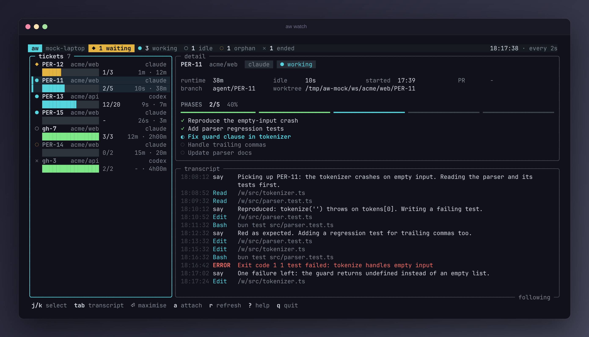

# Watching sessions

Claude Code and Codex can't import a session while it runs, so observe it instead of resuming it, or stop it and take it over with [`open`](hand-off.md#hand-off):

- `tmux attach -t tender`: the live terminals, one window per ticket (`owner/name/ID`). Detach with `Ctrl-b d`; typing there steers the agent.
- `bun tender.ts status [--json]`: per worktree its agent, session (`running`: tmux window and no `<ID>.ended`; `ended`; `handoff`: neither, with `<ID>.handoff`; `orphan`: none of them), live state (see [Live state](#live-state)), runtime (since `<ID>.sh` was written; JSON `startedAt`, ms epoch), idle (since the transcript was last written), phases `done/total` (`.tender/run/phases.json`, else the `<ID>.phases.json` sidecar; JSON also lists up to 20 as `phases.items` with `key`, `title` and `status`, titled by key from the sidecar) and PR (from `<ID>.pr`, which `tender` writes whenever a poll finds the ticket's PR: in progress, and every poll in review (the auto-merge lookup, or with `autoMerge` `off` its own `gh pr list`), so a replaced PR is picked up; must be a `https://github.com/<owner>/<name>/pull/<n>` URL in a regular file under 512 bytes; `held` when `<ID>.merge` records a "not auto-merged" or, in `shadow`, a "would auto-merge" comment for the current head; `ready` while `<ID>.ready` says `tender` moved it to Ready to merge and the move is confirmed). No network calls.
- `bun tender.ts watch [--interval 2] [--plain]`: a terminal dashboard (OpenTUI), refreshed every `--interval` seconds (default 2, min 1); see below. `--plain`, or stdin/stdout not a TTY, redraws the `status` output instead until `Ctrl-C`; if OpenTUI cannot start, or `@opentui/core` is not in a `node_modules` above `src/`, it prints one line to stderr and does the same (that check assumes Bun's default auto-install, which only downloads when no `node_modules` exists; `install.auto = "force"` in a bunfig still fetches).
- `bun tender.ts tail <ID | owner/repo/ID> [-n 20] [--no-follow]`: read-only, one line per assistant message, tool call (name, cut to 6 columns with `…`, and a short argument) or tool error from the newest transcript (last 256 KiB), then follows it, switching (with a new `#` header) to a newer one when the session starts another (restart, `/clear`). Claude's are `<ID>.claude/projects/<cwd, non-alphanumerics as ->/*.jsonl`; Codex's are `<ID>.codex/sessions/**/*.jsonl`; both are matched by the `cwd` they record, and symlinks and non-regular files are skipped. An ID with transcripts in several repos is refused; name the repo. Tool output is never printed; text is capped and stripped of control and escape characters. Works for a finished ticket whose worktree is gone, as long as its transcript is (it goes with the ticket's `<ID>.claude` or `<ID>.codex` at cleanup or restart).

The dashboard has a header (host, a count per state: `◆ waiting` highlighted since it needs you, `◇ question` when any, `● working`, `○ idle`, `◐ handoff`, `◌ orphan`, `✕ ended`, plus `? unknown` when any; the `maxInReview` line while a limit is reached, kept ahead of the host and clock on narrow terminals; last refresh), a footer with the keys that apply right now and transient messages, and between them:

- On a terminal at least 110 columns wide, the ticket list on the left and the selected ticket on the right. Each ticket is a card: state glyph, ID, repo, agent, then a phase progress bar with `done/total`, idle and runtime (one line per ticket when the list is short on rows). Waiting tickets sort first, then question, working, idle, unknown, handoff, orphan, ended, by ID within each; the selection follows the ticket across refreshes. The right side shows the ticket's title row (agent, state and what it is waiting for), runtime, idle, start time, PR (`held` when not auto-merged, `ready` when Ready to merge), branch and worktree, its phases (one bar segment per phase, then a checklist; `+N more` when they don't fit) and below, the live `tail` of its transcript, read incrementally and only for that ticket (wrapped under the message column).
- Narrower terminals stack the list (one line per ticket), the detail and the transcript; below 50 columns or 14 rows only the list and the transcript's last lines are shown.

Colours are truecolor; `NO_COLOR` (set and non-empty) switches to bold, dim and reverse only. Keys:

| key | |
|---|---|
| `j`/`k`, `↓`/`↑` | select; scroll the transcript while it has focus |
| `g` / `G` | first / last; top / follow while the transcript has focus |
| `Tab` | move focus between the list and the transcript (the focused pane has the bright border) |
| `Enter` | maximise the transcript, again to go back |
| `Esc` | close help, or leave the maximised transcript |
| `a` | show the ticket's tmux window: outside tmux the dashboard suspends and runs `tmux attach` (detach with `Ctrl-b d` to come back); inside tmux it runs `tmux switch-client` so your client switches to the `tender` session without nesting (switch back with `Ctrl-b (`/`)` or `L`). Needs a `running` window. |
| `o` | open the PR with `xdg-open` (only `https://github.com/<owner>/<repo>/pull/<n>` links) |
| `r` | refresh now |
| `?` | key help overlay |
| `q`, `Ctrl-C` | quit; the terminal is restored on every exit (also `SIGTERM`, `SIGHUP`, crashes) |

Everything shown is stripped of control, escape, bidi and invisible characters (zero-width joiner and non-joiner are kept for emoji and Persian/Indic text) and cut to the column width. Codex rows show `unknown` without tender's hooks in the template (see [Live state](#live-state)).

## Live state

`state` (`working`, `waiting`, `idle`, `question`, `ended`, `unknown`; JSON also has `waitingFor` and `stateSince`, ms epoch or `null`). An `ended`, `handoff` or `orphan` session is `ended` in JSON; the table and dashboard show a `handoff` or `orphan` session (no tmux window, no `<ID>.ended`) as such. Otherwise:

- Claude: the session records `claude agents` reads, `<ID>.claude/sessions/<pid>.json`, once per refresh for each Claude ticket with a tmux window. `tender` reads them itself, never running `claude` against a dir the session can write: no symlinks, regular files under 64 KiB, and only records whose pid is still running with the recorded start time. `busy` is `working`, `waiting` carries `waitingFor`. The session must report the worktree path as its exact `cwd`. The format is undocumented (checked on 2.1.323): if it changes, Claude rows show `unknown`.
- Codex: hooks installed by `scripts/setup.sh` (via `scripts/codex-hooks.sh`, a marked block in `~/.codex-tender/config.toml`; the rest of the file is left alone, and the script refuses damaged markers or a result that is not valid TOML; a Codex start whose template lacks the markers logs the fix and still starts, since such a session never reads `idle` and so gets no answers or PR feedback) write `{state, ts}` to `<worktree>/.tender/run/codex-state.json` on `SessionStart`/`Stop` (idle), `UserPromptSubmit`/`PostToolUse` (working), `PermissionRequest` (waiting) and `SessionEnd` (ended), only when `.tender/run` is a real directory. The sandbox only lets an agent write its own worktree, so it can at most misreport its own state. The hook runs with the agent's own privileges, so a race on `.tender/run` or the temp file reaches nothing the agent could not write anyway. It assumes the session starts at the worktree root, as the launcher does. Codex keys hook trust on the config file's path, so a fresh `<ID>.codex` would skip them; the launcher passes `--dangerously-bypass-hook-trust` instead, since the hooks come only from the template, which sessions cannot write. That also runs hooks from the repo's own `.codex/` config untrusted, with the session's own privileges. `tender` reads the file like `phases.json` (no symlinks, regular file under 4 KiB) and only if it is newer than the launcher; a `working` older than 10 minutes with no transcript write since is `unknown`.
